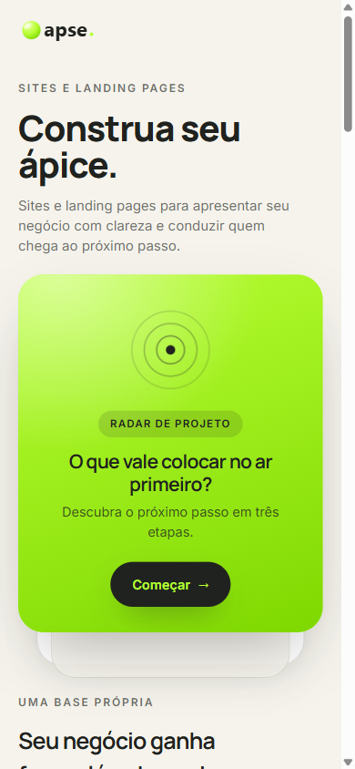
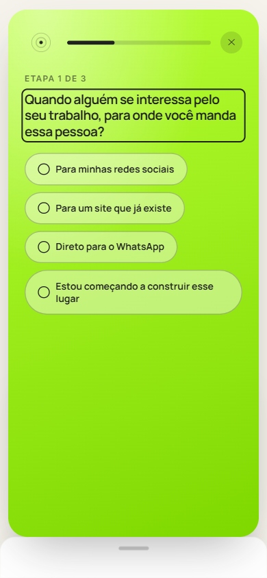
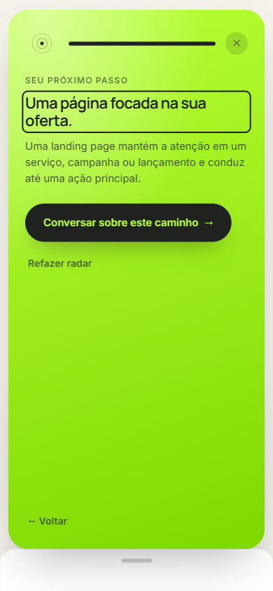
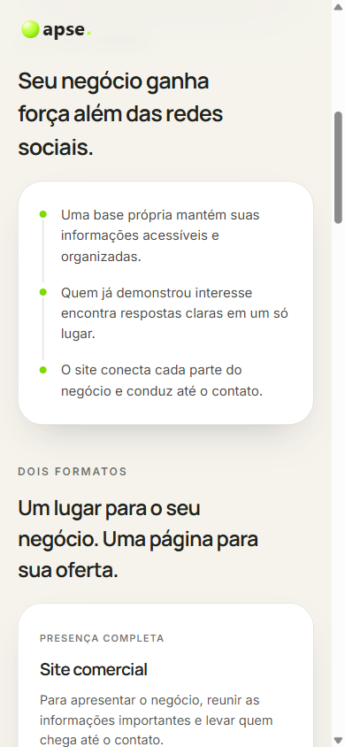
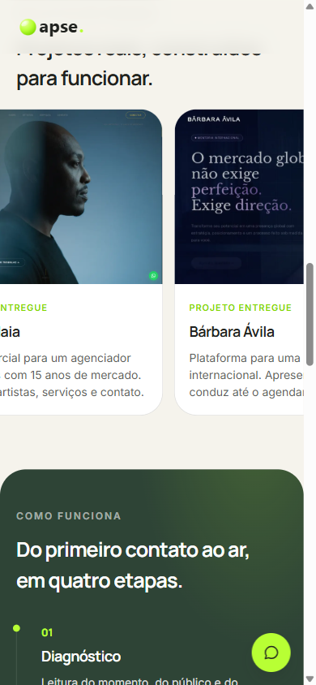
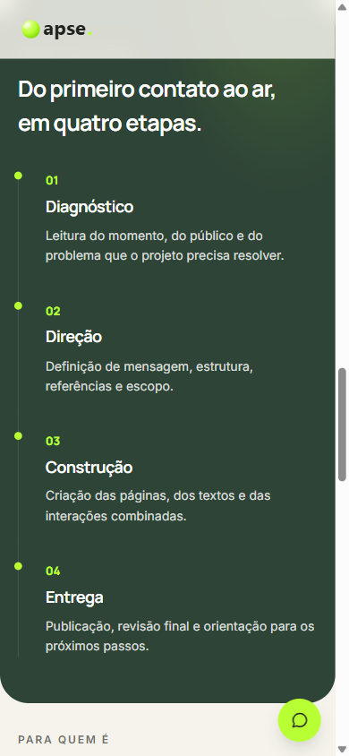
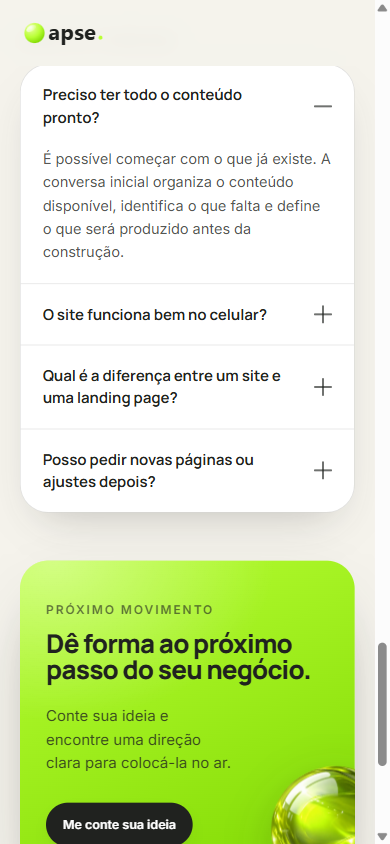
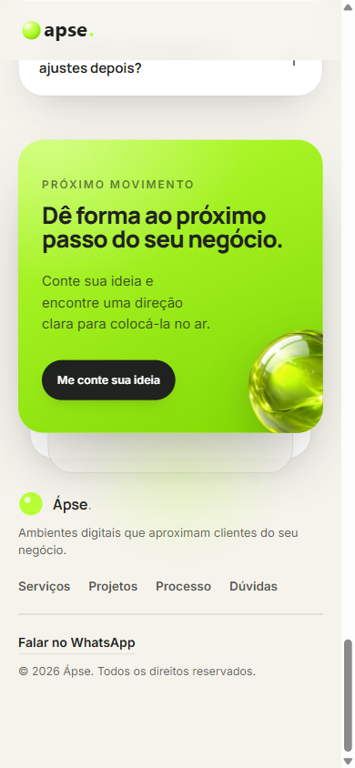

# Ápse

Site comercial e landing page para a Ápse, um estúdio de sites e landing pages. Construído do zero em HTML, CSS e JavaScript puros, sem framework e sem dependência nenhuma.

## Destaques técnicos

- **Radar de projeto**: questionário de três etapas que recomenda o formato certo (site comercial ou landing page) com base nas respostas, e monta uma mensagem de WhatsApp já preenchida com o resultado.
- **Carrossel de portfólio contínuo**: no mobile, rolagem automática infinita construída com `requestAnimationFrame` (sem biblioteca), com pausa em toque/arraste e retomada suave; no desktop, alternância automática do projeto em destaque com transição de opacidade.
- **Botão de WhatsApp flutuante contextual**: aparece só depois da dobra inicial e some de novo ao chegar no CTA final, via `IntersectionObserver`.
- **FAQ em sanfona exclusiva** com transição de altura por CSS Grid (`grid-template-rows: 0fr → 1fr`), acessível por teclado.
- **`prefers-reduced-motion` respeitado** em todas as animações e no carrossel automático.
- Zero build step: um servidor Node de arquivo estático (`server.mjs`) sem dependências externas.

## Rodando localmente

```bash
node server.mjs
```

Abre em `http://localhost:5000`.

## Prints

| Hero + Radar | Radar em etapa | Resultado do radar |
|---|---|---|
|  |  |  |

| Problema + Oferta | Portfólio | Processo |
|---|---|---|
|  |  |  |

| FAQ | CTA final + Rodapé |
|---|---|
|  |  |
