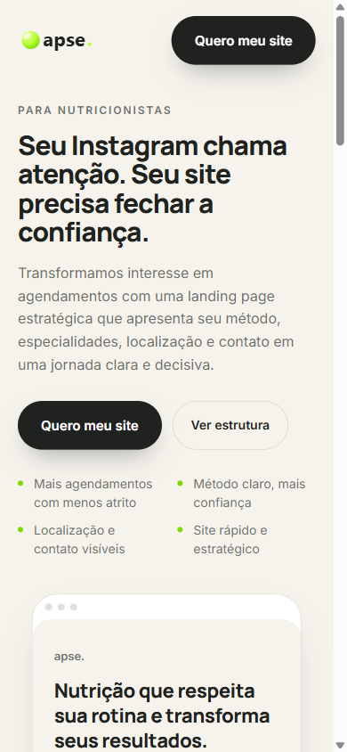
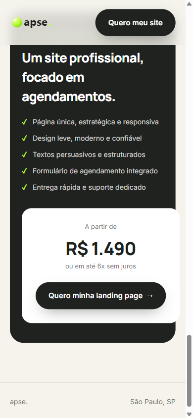

# Ápse — Landing page para nutricionistas

Exemplo de landing page de venda de um formato específico da Ápse: um site de estreia para nutricionistas, focado em transformar interesse do Instagram em agendamento. Usa os mesmos tokens e componentes do site institucional (`../assets/css/styles.css`), com um `styles.css` próprio só para os blocos exclusivos desta página.

## Estrutura

- Hero com proposta de valor e mock da página final do cliente
- Problema x solução (o que se perde sem site x o que se ganha com um)
- Estrutura recomendada (Sobre, Especialidades, Método, FAQ, Agendamento, Contato)
- Exemplo visual dos blocos principais
- Card de preço com CTA direto para WhatsApp

## Rodando localmente

A partir da raiz do projeto:

```bash
node server.mjs
```

Abre em `http://localhost:5000/nutricionista/`.

## Prints

| Hero | Preço |
|---|---|
|  |  |
